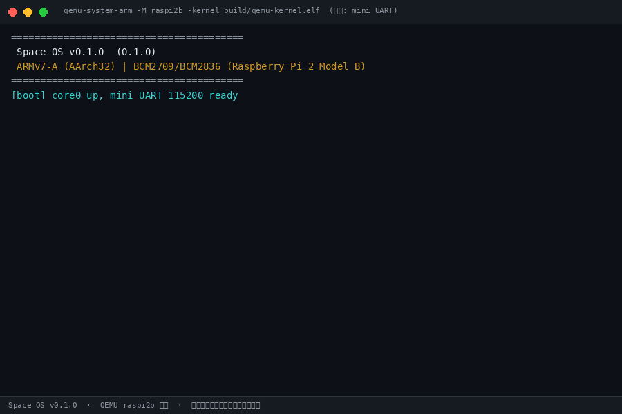
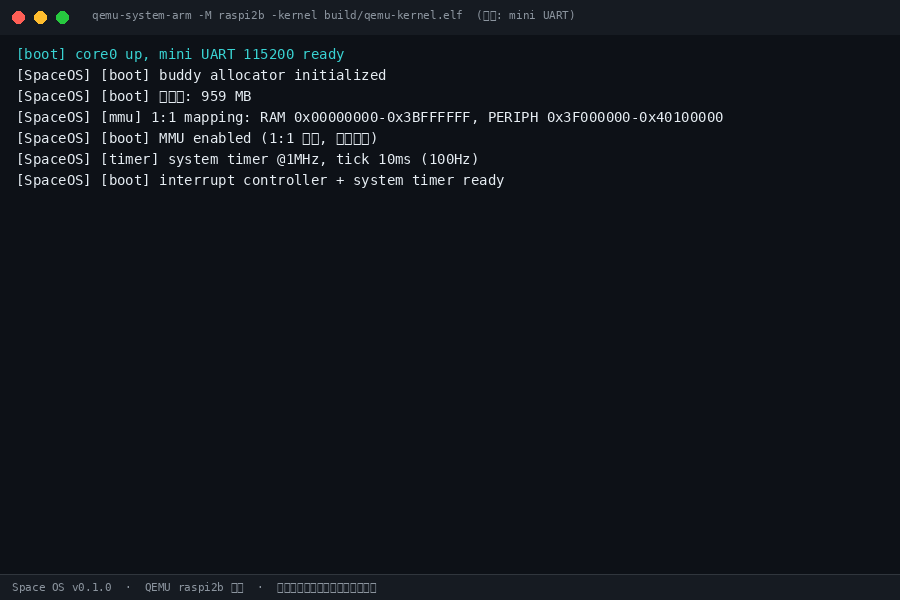
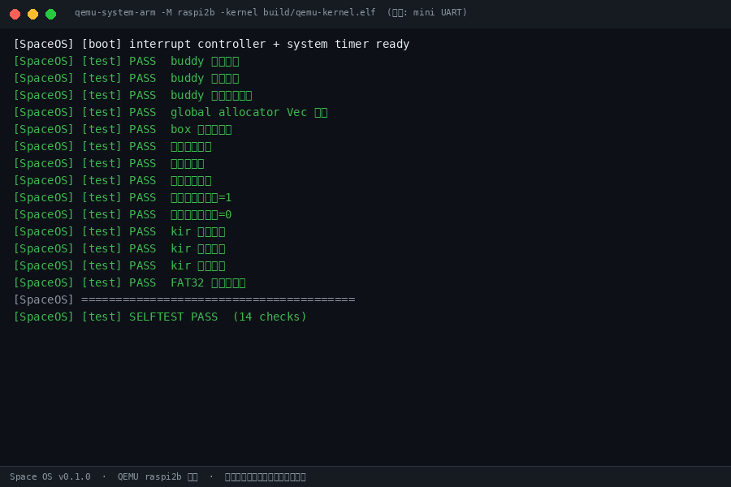
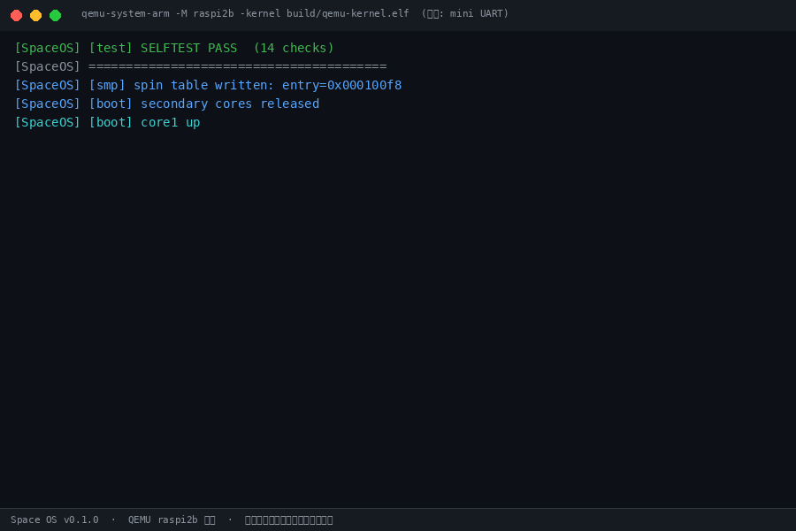
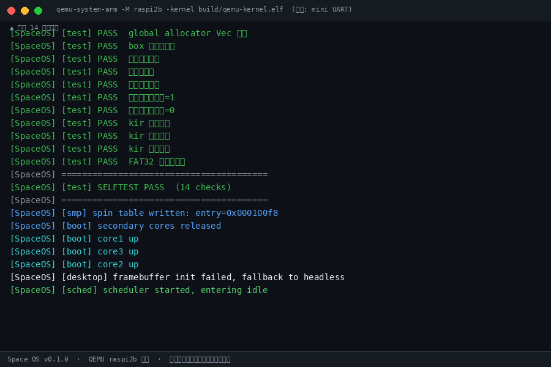

# KiraX OS

> 从零用 Rust + ARM 汇编写的**多平台裸机操作系统**（无 Linux 内核、无发行版、无第三方图形库）。
> 首个目标平台为树莓派 2/3（ARMv7-A / AArch64），1.0.0 起引入 **BSP 板级抽象层**，向 QEMU ARM `virt`（PC 上的通用虚拟机平台）扩展——不再绑定单一硬件。
> 深空星球主题 + 液态玻璃桌面；自带 `.kir` 应用生态与 **APK 兼容层**（自研 DEX 执行引擎，路线图第 1 步已落地）。

## 1.0.0 里程碑

- **正式更名 KiraX OS**（原 Space OS）：全仓品牌、crate 名（kirax-core / kirax-dex / kirax-kernel）、镜像卷标统一。
- **BSP 抽象层**：`kernel/src/board/`——外设地址集中为板级表，`raspi`（生产）与 `virt`（QEMU 虚拟机骨架）经 `--features board_virt` 切换；`qemu/run-raspi.sh`、`qemu/run-virt.sh` 两个启动入口。
- **APK 兼容层引擎**：no_std 手写 Deflate 解压 + DEX 解码报告 + 方法级 `.kir` 转译骨架（真实 APK 端到端，0 未支持指令）。
- **打包链路修复**：`pack-apkcompat.py` 改 llvm-objcopy 通配段提取，code 段从 1840B 修正为真实的 162566B。

## 快速开始

```bash
# 1. 安装依赖（Ubuntu/Debian，环境被重置时用脚本一键恢复）
bash tools/setup-toolchain.sh     # qemu + gdb + arm-none-eabi + apt 源/代理

# 2. 安装 Rust target
rustup target add thumbv7a-none-eabi aarch64-unknown-none

# 3. 构建并生成统一镜像（一张 SD 卡覆盖全部机型）
make all               # 统一 32 位内核 build/kernel7.img（启动时读 MIDR 自动识别 Pi2/Pi3）
make pi3-aarch64       # AArch64 内核 build/pi3-aarch64/kernel8.img
make qemu              # QEMU 快速验证（Pi2 模拟：mini UART）
make pi3-aarch64-qemu  # QEMU 验证 AArch64（raspi3b 机型）

# 4. 生成最终 SD 镜像（256MB，含 KERNEL7.IMG + KERNEL8.IMG + CONFIG.TXT）
python3 scripts/make-sdimg.py build/kernel7.img build/kirax-os.img --model pi3 --kernel64 build/pi3-aarch64/kernel8.img

# 5. 烧录（唯一交付镜像）
sudo dd if=build/kirax-os.img of=/dev/sdX bs=4M conv=fsync
#    Pi3 → 默认 AArch64 桌面；Pi2 → 旧固件忽略 arm_64bit 自动加载统一 32 位内核
```

### 虚拟机运行（不插 SD 卡）

```bash
# 树莓派模拟（已验证）
./qemu/run-raspi.sh

# QEMU ARM virt（PC 虚拟机通用平台；地址表已切，GIC/virtio 驱动适配中）
cargo build --manifest-path kernel/Cargo.toml --target thumbv7a-none-eabi --release --features board_virt
./qemu/run-virt.sh
```

## 目录结构

```
kirax-os/
├── boot/                 # 启动汇编 + 链接脚本
│   ├── start.S           # ARMv7 启动 stub（0x10000 QEMU / 0x8000 真机双态）
│   ├── start64.S         # AArch64 启动副本（等价冗余；实际由 kernel/src/start64.rs 的 global_asm! 内嵌进 .a，勿再链接）
│   ├── linker.ld         # 真机链接脚本（0x8000）
│   ├── linker-qemu.ld    # QEMU 链接脚本（0x10000）
│   └── linker64.ld       # AArch64 链接脚本（0x80000）
├── kernel/               # Rust 内核 crate
│   └── src/
│       ├── main.rs       # 内核入口（SOC 运行时检测，统一镜像）
│       ├── soc.rs         # MIDR 运行时识别 Pi2/Pi3（统一镜像核心）
│       ├── console.rs    # 串口转发层（soc::use_pl011() 运行时选择 mini UART / PL011）
│       ├── uart.rs / pl011.rs   # mini UART / PL011 驱动（Pi3 自配 cprman 时钟）
│       ├── memory.rs / mmu.rs   # 物理内存/伙伴堆 / MMU 页表
│       ├── timer.rs / irq.rs / exception.rs / sync.rs / scheduler.rs / syscall.rs
│       ├── mailbox.rs / framebuffer.rs / font.rs   # GPU mailbox / 帧缓冲 / 8×8 位图字体
│       ├── sd.rs / usb/  # EMMC/SD 卡 / USB DWC2 HID
│       ├── graphics/ / window/ / desktop/   # 绘制原语 / 窗口管理 / 玻璃桌面
│       ├── kir/          # .kir(SKIR) 加载器
│       ├── start64.rs    # AArch64 启动（global_asm! 内嵌，EL2→EL1、VMSAv8-64 页表）
│       └── selftest.rs   # 板载自检（14 项）
├── crates/kirax-core/    # 与内核解耦的纯算法库（host 可单测）
│   └── src/
│       ├── buddy.rs      # 伙伴分配器
│       ├── blend.rs / blur.rs   # Alpha 混合 / 三次盒式高斯模糊
│       ├── roundrect.rs / rr_check.rs   # 圆角矩形 SDF / 校验
│       ├── fat32.rs      # FAT32 只读驱动
│       ├── fmath.rs      # 无 libm 的浮点工具
│       ├── events.rs / glass.rs   # 输入事件环 / Glass 设计令牌（权威色板）
│       └── kir.rs        # .kir(SKIR) 32B 定长头应用二进制格式
├── apps/                 # 系统自带 .kir 应用（about/calculator/clock/editor/hello/terminal，各含 manifest.json）
│   └── apkcompat/        # APK 兼容器（Rust 工程，ZIP/AXML 解析 + 兼容层，产出 apkcompat.kir）
├── tools/
│   ├── kirax-cli/        # build/run/package/install 命令行（附 README）
│   ├── kirpm/            # .kir 包管理器
│   ├── vscode-kirax/     # VS Code 扩展（语法高亮 + language-configuration）
│   ├── fontgen/          # 字体生成工具（空占位目录，暂无代码）
│   └── setup-toolchain.sh  # 工具链一键恢复（qemu/gdb/arm-none-eabi/apt 源）
├── kirax-studio/         # 图形化 IDE（Tauri → Windows exe/setup / cargo-ndk → Android APK）
├── specs/GLASS_DESIGN.md # Glass 设计规范（色值/透明度/模糊半径，与 crates/kirax-core/src/glass.rs 对齐）
├── docs/                 # 开发文档（01 裸机 … 07 工具链、08 Pi3 适配、09 UTM 存档）
├── scripts/              # pack-apkcompat.py 打包、make-sdimg.py 生成 SD 镜像
├── tests/run_tests.sh    # 一键测试脚本
├── qemu/                 # gdb_script.gdb（Pi2）+ gdb_script_pi3.gdb（Pi3）
└── build/                # 构建产物（pi3/、pi3-aarch64/ 子目录 + *.img SD 镜像）
```

## 构建产物

| 文件 | 用途 | 基址 |
|---|---|---|
| `build/qemu-kernel.elf` | QEMU `-kernel` 加载（Pi2） | 0x10000 |
| `build/kernel.elf` / `build/kernel7.img` | 真机 ELF / 裸二进制（Pi2） | 0x8000 |
| `build/pi3/qemu-kernel.elf` | QEMU `-kernel` 加载（Pi3，PL011） | 0x10000 |
| `build/pi3/kernel.elf` / `build/pi3/kernel7.img` | 真机 ELF / 裸二进制（Pi3，AArch32） | 0x8000 |
| `build/pi3-aarch64/kernel8.elf` / `build/pi3-aarch64/kernel8.img` | 真机 ELF / 裸二进制（Pi3，AArch64） | 0x80000 |
| `build/kirax-os.img` | **256MB 统一 raw SD 镜像**（KERNEL7.IMG + KERNEL8.IMG + CONFIG.TXT；Pi2/Pi3 双兼容） | — |
| `apps/apkcompat/apkcompat.kir` | APK 兼容器自带应用（SKIR 32B 头） | — |

## 当前状态

- 阶段一（裸机 UART）：完成，QEMU 点亮 banner。
- 阶段二（内核核心）：buddy 分配器、MMU 1:1、timer、irq 跑通；**板载自检 14/14 PASS**（统一内核 + 强制 PL011 版 + AArch64 三路径均通过），四核唤醒、调度器 idle。
- 算法库（kirax-core）：**host 单测 57/57 PASS**（buddy/blend/blur/roundrect/fat32/fmath/events/glass/kir + rr_check 圆角描边断言）；其中 `kir.rs` 已从旧 KIR1 重写为生态实际的 **SKIR 32B 定长头**线格式，模块单测 6→9 个。
- **统一镜像**：`kernel/src/soc.rs` 启动时读 MIDR 识别 Pi2（Cortex-A7）/Pi3（Cortex-A53），一份 32 位内核 + 一份 AArch64 内核合入单镜像 `kirax-os.img`，一张 SD 卡覆盖全部机型。
- **零告警**：三个 target（thumbv7a-none-eabi / +pi3 feature / aarch64-unknown-none）编译均 0 error 0 warning；`make test` 三路径 QEMU 自检 14/14，5 轮稳定性重复测试全 PASS。
- **Pi3 适配**：PL011 驱动 + 自配 cprman 时钟；QEMU 验证 14/14 PASS。坑点与排查见 `docs/08-pi3.md`。
- **Pi3 AArch64**：新增 `make pi3-aarch64` → `build/pi3-aarch64/kernel8.img`（用 rust-lld/llvm-objcopy；AArch64 启动代码由 `kernel/src/start64.rs` 的 `global_asm!` 内嵌进 `libkirax_kernel.a`，**不依赖** `boot/start64.S`——后者是等价冗余副本，链接会与库内 `_start`/`mmu_init_64`/`_vectors`/`_page_l1` 重复定义）。
- **APK 兼容器**（`apps/apkcompat/`）：ZIP 容器 + AndroidManifest 二进制 XML 解析真实可运行，**host 单测 6/6 PASS**，已打包 `apkcompat.kir` 并自验证。DEX 解释器 / Binder 抽象 / ART 对象模型列入路线图。
- 阶段三~五：驱动、玻璃桌面、.kir 生态代码骨架与文档就绪，真机验证待做。
- 阶段六（KiraX Studio）：**三平台真产物已交付**——Windows `KiraXStudio.exe`（AS 风格 IDE：项目树/编辑器 tab/行号/输出窗/状态栏）、NSIS 安装器（含 WebView2Loader.dll）、Android APK（arm64-v8a/armeabi-v7a/x86_64 三 ABI，JNI 入口已修复）。构建命令与产物见 `kirax-studio/README.md`。

## 真机烧录

```bash
# 统一镜像（推荐）：一条 dd 完事，无需手动分区
sudo dd if=build/kirax-os.img of=/dev/sdX bs=4M conv=fsync

# 手动方式（等价）：镜像内已含 FAT16 分区 + config.txt
#   build/kernel7.img  → /boot/kernel7.img（统一 32 位：Pi2/Pi3 自动识别）
#   build/pi3-aarch64/kernel8.img → /boot/kernel8.img（Pi3 AArch64）
# config.txt（镜像内已生成）：
#   arm_64bit=1
#   enable_uart=1
#   dtoverlay=pi3-miniuart-bt
#   arm_freq=900
#   gpu_mem=16
#   disable_overscan=1
```

## 演示（QEMU 真实运行）

以下为 `qemu-system-arm -M raspi2b -kernel build/qemu-kernel.elf` 真实启动的串口输出截图（`screenshots/`）：











> 说明：图形桌面（玻璃桌面）已接入启动流程（`kernel/src/framebuffer.rs` 的 MMU 段映射 + `kernel/src/main.rs` 的桌面启动分支，mailbox 驱动带有限轮询超时）。QEMU 6.x 未实现树莓派 framebuffer 邮箱分配，内核在模拟器下会自动回退 headless 调度器；在真实 Pi2/Pi3 上可正常初始化 framebuffer 并显示桌面。
